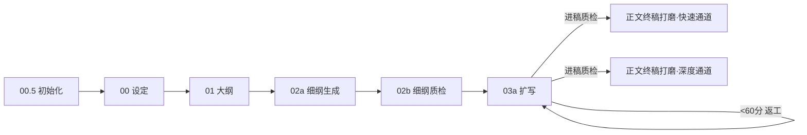

# 项目初始化师 V1.0

> 本技能填补了原流水线的"项目文件系统"空白。在设定架构之前执行，为全书工程提供统一目录结构和跨会话追踪能力。

---

## 📍 在完整流水线中的位置

> 本技能是完整流水线的第一个节点（00.5 初始化）。流水线总览见下方 mermaid 图；图中各下游技能均消费本项目骨架中的挂载点。



> **当前步骤**：Step 0 — 项目初始化

> **核心使命**：在设定和大纲之前，先建立全书工程骨架，确保所有产出物路径统一、跨会话可追踪。

---

## 执行流程

### 第一步：确认项目基本信息

> **⚠️ Inversion Gate（硬阻断）**
> 在以下 6 项必填信息全部确认前，**禁止执行 Step 2 及后续步骤**。
> 任何一项缺失 = 项目骨架不完整 = 下游 00 设定架构师无法正确工作。
> 如用户表示"先建目录，信息后补"，须明确告知：缺少必填信息将导致 02a 衔接包 P0 字段缺失、进稿质检评分降级、终稿打磨质量存疑（需人工复核）。

与用户确认以下信息：

| 信息 | 说明 |
|------|------|
| 书名 | 最终书名（如未定，用暂定名） |
| 作者 | 笔名 |
| 类型 | 都市/玄幻/悬疑/言情等 |
| 平台 | 番茄小说/七猫/起点/晋江/B站轻小说/飞卢/纵横/知乎盐言/通用 |
| 预计总字数 | 如100万字 |
| 项目根目录 | 存放路径，如 `C:\Users\xxx\Desktop\小说\书名\` |

### Gate 检查清单（全部为 ✅ 方可进入 Step 2）

- [ ] 书名已确认（非空，非"暂定"）
- [ ] 作者已确认（非空）
- [ ] 题材已确认（须匹配 00 设定架构师支持的题材列表）
- [ ] 目标平台已确认（番茄/七猫/起点/晋江/B站轻小说/飞卢/纵横/知乎盐言/通用）
- [ ] 预计总字数已确认（须为数字，≥3万）
- [ ] 项目根目录已确认（路径存在且可写）

> 如有任何一项为 ❌，**停止执行**，向用户说明缺失项并请求补充。

### 第二步：生成标准目录结构

**前置检查**：确认 Step 1 的 Gate 检查清单全部为 ✅。如有 ❌ 项，返回 Step 1。

在项目根目录创建以下通用挂载点骨架。目录是挂载点，本技能只填充 `追踪/上下文管理模板.md` 与 `项目日志.md`；`←` 右侧注明各下游技能按自身约定写入的产出（各下游技能按自身约定命名，此处为通用挂载点）：

```
{书名}/
├── 设定包/                            ← 00 小说设定架构师产出（旧项目可能用 设定/，hooks 两处都查）
│   ├── 00_创作简报.md                 ← 一句话前提/读者承诺/人物因果/未决项
│   ├── 01_设定元数据.json             ← 机器元数据（novel/world/characters/relationships 等根字段）
│   ├── 02_写作约束.json               ← 禁写/必写动作、场景测试、人物声口
│   └── manifest.json                  ← 设定包清单（package_files/consumer_read_order 等）
├── 大纲/                              ← 01 小说大纲构建师产出
│   ├── 00_大纲简报.md                 ← 面向作者的方向/读者承诺/分卷因果简报
│   ├── 01_大纲数据.json               ← 规范大纲机器资产（finalize_outline.py 校验）
│   ├── 03_审计回执.json               ← 质量凭证（status=passed 方可交付）
│   └── 03_连续性账本.json             ← 连续性派生保障（跨批核验）
├── 细纲/                              ← 02a 细纲生成产出
│   ├── 卷X_细纲与衔接.md              ← 卷级细纲与衔接说明
│   ├── 卷X_delta.json                 ← 卷级变更 delta（代码校验）
│   └── ...（逐章 *_细纲.md / *_衔接包.md / chapter_delta_ChX.json / *handoff*.json，命名以 02a 约定为准）
├── 正文/
│   ├── 初稿/                          ← 03a 细纲扩写执行产出（如 Ch1_初稿.md）
│   └── 终稿/                          ← 正文终稿打磨师产出（如 Ch1_终稿.md；V1.3.0 已合并原精修+去AI味，为唯一终稿环节）
├── 追踪/                              ← 跨会话追踪（本技能填充 上下文管理模板.md）
│   ├── 上下文管理模板.md              ← 跨会话追踪核心
│   ├── 伏笔追踪表.md                  ← 伏笔全生命周期（写作中登记）
│   └── ...（角色状态.md/时间线.md/compact-snapshots/ 等由各 hook 按需维护）
├── 拆文库/                            ← 06拆文师产出（执行拆文时按需自建，目录结构以小说拆文师 SKILL.md 为准）
└── 项目日志.md                        ← 记录每次会话的任务（session-start/session-end hook 追加）
```

### 第二点五步：知识库挂载检查（2026-08-30 新增）

> 写作方法论知识库为**共享资产**（不在项目内复制），本步只做检测与路径登记。缺失仅提示，不阻断初始化。

```
检查项：
├─ 1. 技能侧知识库：C:/fuhui/ObsidianStore/writer/方法论库/（卡片以 md 为主，json 为资料副本；20 情节卡/7 理论卡/82 练习卡/3 checklist）
│     ├─ 存在 → 在 追踪/上下文管理模板.md 的"上游依赖文件"登记引用路径
│     └─ 缺失 → 提示"知识库未就位，细纲生成/扩写/审稿的情节卡引用将降级"，继续
├─ 2. Obsidian 视图：C:/fuhui/ObsidianStore/writer/方法论库/（人读图谱）
│     ├─ 存在 → 在报告"知识库挂载"栏标注 ✅
│     └─ 缺失 → 提示可重新生成，继续
└─ 3. 使用约定（写入模板）：
      ├─ 细纲生成：【章节结构】标注主导情节类型（读 plotNN 卡 use_when）
      ├─ 扩写：读细纲标注的那 1 张情节卡（只读，禁全量）
      ├─ 审稿：加载 规则与清单/ 3 份 checklist
      └─ 库不可读 → 降级不阻断
```

### 第三步：填充上下文管理模板

基于项目信息自动填充 `追踪/上下文管理模板.md`，包含：

- 基本信息（书名/作者/类型/平台）
- 当前进度（初始化为第1卷第0章）
- 角色状态表（预留空表，待设定文档填充）
- 伏笔追踪表（预留空表）
- 文件索引（指向标准目录下的各文件路径）
- 快速恢复命令（预填书名和路径）

### 第三点五步：Hook自动配置（V5.3新增）

运行 `node scripts/setup-hooks.js` 自动检测平台并配置hooks。

支持平台：Trae / Claude Code / OpenCode / Codex

配置后自动启用：
- **check-prose-after-write**（写后兜底）：每章写作完成后自动检测AI味模式
- **chapter-counter**（章节计数提醒）：自动追踪章节进度
- **session-start**（会话启动检查）：每次会话开始时验证上下文完整性
- **guard-outline-before-prose**（写前大纲守卫）：阻断无细纲直接写正文
- **detect-story-gaps**（故事缺口检测）：自动发现剧情漏洞
- **pre-compact**（压缩前检查）：上下文压缩前保留关键信息
- **post-chapter-update**（章节后更新）：章节完成后更新追踪文件
- **session-end**（会话结束检查）：会话结束时保存状态
- **check-rhythm-cross-chapter**（跨章节奏检测）：检测跨章节节奏连贯性

> 脚本会根据操作系统自动选择 `.ps1`（Windows）或 `.sh`（Unix/macOS）版本的 hook 文件。

### 第四步：输出项目初始化报告

```
【项目初始化报告】

书名：{书名}
作者：{作者}
类型：{类型}
平台：{平台}
预计字数：{预计字数}

目录结构已创建：{路径}
上下文管理模板已生成：{路径}/追踪/上下文管理模板.md

下一步：
→ 00 小说设定架构师（填写角色/世界观/JSON元数据/写作约束）
→ 01 小说大纲构建师（规划分卷/情绪曲线，产出 01_大纲数据.json）
→ 02a 细纲生成 → 02b 细纲质检 → 03a 细纲扩写执行 → 正文终稿打磨师
```

---

## 上下文管理模板（标准版）

> 以下为自动生成的模板内容。每次会话开始和结束时更新。

```markdown
# 上下文管理模板

> 本模板用于跨会话的上下文管理，保证断点续跑时不丢失关键信息。

---

## 当前项目状态

### 基本信息

| 项目 | 内容 |
|------|------|
| 书名 | [{书名}] |
| 当前进度 | 第1卷 / 第0章 |
| 上次会话结束状态 | 项目初始化完成 |
| 下次会话起始任务 | 从 00 设定架构师开始 |

### 当前活跃角色状态

| 角色 | 位置 | 身体状态 | 心理状态 | 关键持有物 | 战力等级 | 生死状态 |
|------|------|---------|---------|-----------|---------|---------|
| [主角] | [地点] | [状态] | [状态] | [物品] | [题材适配：玄幻=战力等级/都市=资源量级/言情=关系阶段/悬疑=推理阶段] | 存活 |
| [配角1] | [地点] | [状态] | [状态] | [物品] | [题材适配：玄幻=战力等级/都市=资源量级/言情=关系阶段/悬疑=推理阶段] | 存活 |

> **V3.5新增**：战力等级和生死状态列由00设定架构师的 `number_anchors` 和 `power_system` 填充，跨会话恢复时必须携带。每章完成后由02衔接包的[本章新增状态]同步更新（如角色突破/死亡）。

### 当前活跃伏笔

| ID | 伏笔名 | 埋设章 | 内容 | 预计回收 | 状态 |
|----|--------|:------:|------|:--------:|------|
| F001 | | Ch. | | Ch. | ACTIVE |

### 当前未解决的冲突/悬念

- [ ] [冲突1描述]

---

## 断点续跑检查清单

```
□ 上次写到哪一章了？
□ 那一章的状态是什么？（初稿 → 终稿；终稿由正文终稿打磨师产出）
□ 当前角色的位置/伤势/关系状态？
□ 当前角色的战力等级和生死状态？（V3.5新增 — 对照number_anchors）
□ 有哪些伏笔还没回收？预计在哪章回收？
□ 衔接包链是否完整？（Ch.X → Ch.X+1 的衔接包是否存在）
□ 本章需要加载的上下游文件有哪些？
```

---

## 文件索引

### 上游依赖文件（只读）

| 文件 | 说明 | 路径 |
|------|------|------|
| 设定包四件套 | 00 设定架构师产出 | `设定包/`（00_创作简报.md + 01_设定元数据.json + 02_写作约束.json + manifest.json） |
| 大纲产出 | 01 大纲构建师产出 | `大纲/`（00_大纲简报.md + 01_大纲数据.json + 03_审计回执.json） |
| 卷细纲与衔接 | 02a 细纲生成产出 | `细纲/卷X_细纲与衔接.md` |

### 当前工作文件

| 文件 | 说明 | 状态 |
|------|------|------|
| 第X章初稿 | 03a 细纲扩写执行产出 | [写作中/已完成] |
| 第X章终稿 | 正文终稿打磨师产出（V1.3.0 合并精修+去AI味后的唯一终稿环节） | [未开始/已完成] |

---

## 快速恢复命令

```
我正在写一本网文《{书名}》，当前进度第[X]卷第[X]章。
上次会话完成了：[具体任务]
当前角色状态：[主角]在[地点]，[身体状态]，[心理状态]
当前活跃伏笔：[简要列出]
未解决冲突：[简要列出]
下一步：[具体任务描述]
```

---

## 每章完成后的更新清单

```
□ 更新"当前进度"字段
□ 更新"当前活跃角色状态"表
□ 更新"当前活跃伏笔"表
□ 更新"当前未解决的冲突/悬念"
□ 记录本次会话到"会话记录"
□ 更新"文件索引"中的工作文件状态
□ 更新"快速恢复命令"模板中的关键信息
```
```

---

## 流水线契约

- **本技能只在项目启动时执行1次**，不是每章循环
- **产出目录结构**后，后续所有技能按照约定路径读写文件
- **上下文管理模板**由用户或外部脚本更新，本技能不负责自动维护
- **拆文库/** 预留给06拆文师使用（由拆文师执行时按需自建，本技能只留挂载点），如不使用拆文可忽略
- **本技能不收集创作素材**：用户已有的设定/灵感/旧稿素材由 00 设定架构师负责收集。项目初始化只建骨架，不填内容
- **第0步是全书第1步**：即使从后续步骤开始，也应确认项目目录结构是否存在——若不存在或路径不统一，先补执行项目初始化

---

## Inversion Gate 设计说明

本技能采用 Inversion 模式的硬阻断设计：
- 必填信息未收集完成前，禁止生成目录结构和填充模板
- 这是防止"半成品骨架"流入下游步骤的工程保障
- 与 00 设定架构师的"创作内容收集"形成互补：
  - 00.5 管"工程骨架"（硬阻断）
  - 00 管"创作内容"（软引导）
